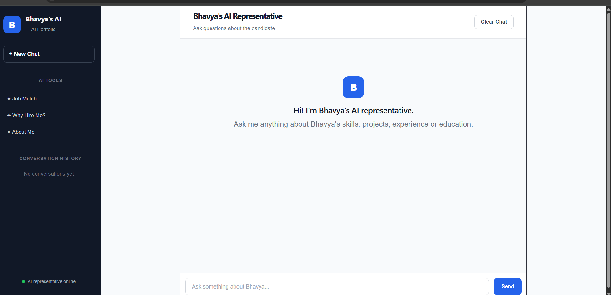
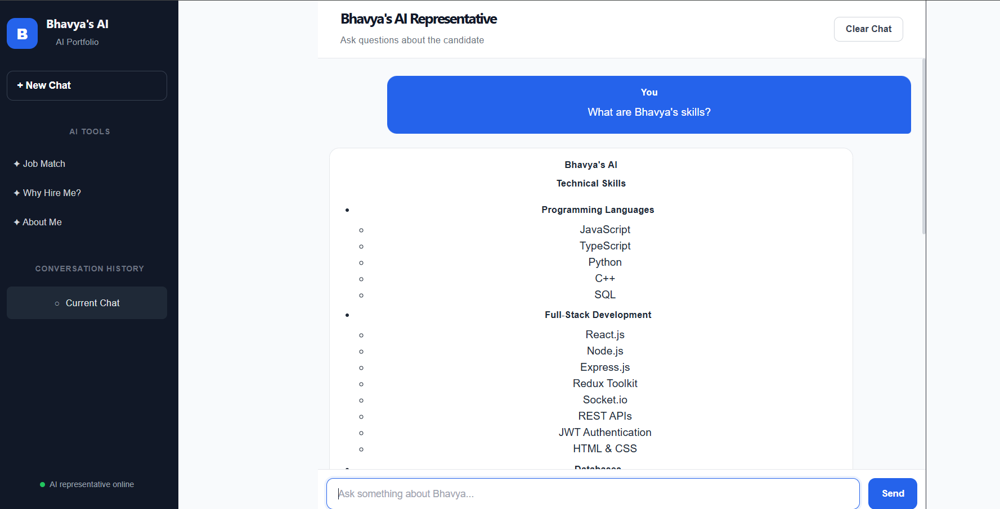
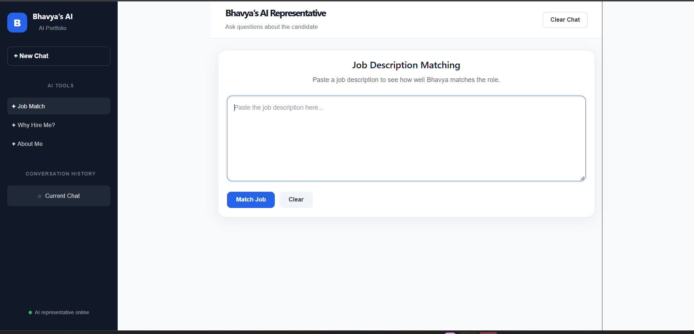
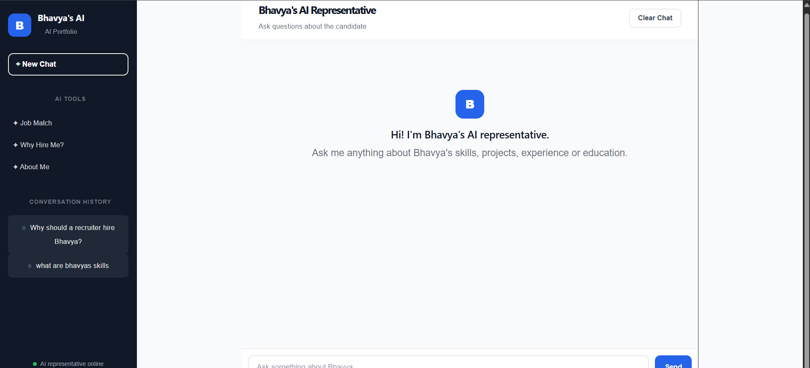

Bhavya's AI Portfolio
An interactive AI-powered portfolio that lets recruiters chat with an AI representative of Bhavya Nigam and explore her skills, projects, education, experience, and job fit.
🚀 Live Demo
Frontend: https://ai-portfolio-seven-alpha.vercel.app
Backend: https://ai-portfolio-backend-0icc.onrender.com
✨ Features
🤖 AI portfolio chat powered by Groq LLM
💬 Streaming AI responses for a natural chat experience
🧠 Conversation history with local persistence
🔄 Multi-turn conversation context
🎯 Job Description Matching with match percentage
📋 Matching skills, relevant experience/projects, and skill gaps
⚡ FastAPI backend with React/Vite frontend
🔐 Candidate information constrained by a structured JSON profile
📱 Clean, responsive portfolio interface
📸 Screenshots
AI Portfolio

AI Chat

Job Description Matching

Conversation History

🛠️ Tech Stack
Frontend
React.js
Vite
JavaScript
CSS
React Markdown
remark-gfm
Backend
Python
FastAPI
Uvicorn
Pydantic
Groq API
python-dotenv
AI
Groq
`openai/gpt-oss-120b`
Deployment
Vercel — Frontend
Render — Backend
🏗️ Project Structure
```text
AI-portfolio/
├── backend/
│   ├── data/
│   │   └── candidate.json
│   ├── main.py
│   ├── models.py
│   ├── requirements.txt
│   └── .env
│
├── frontend/
│   ├── src/
│   ├── package.json
│   └── ...
│
├── screenshots/
│   ├── home.png
│   ├── chat.png
│   ├── job-match.png
│   └── history.png
│
└── README.md
```
🔄 How It Works
```text
Recruiter
   ↓
React Chat UI
   ↓
FastAPI /chat endpoint
   ↓
Candidate JSON + Conversation History
   ↓
Groq LLM
   ↓
Streaming Response
   ↓
React UI
```
For job matching:
```text
Job Description
      ↓
React Job Match UI
      ↓
FastAPI /match-job
      ↓
Candidate Profile + Job Description
      ↓
Groq LLM
      ↓
Structured Match Result
```
🧠 AI Accuracy & Safety
The AI representative is instructed to answer only from the candidate information provided in `candidate.json` and the current conversation context.
If information is not available, the assistant is expected to say that it does not have that information instead of inventing an answer.
👩‍💻 Candidate Information
The portfolio currently represents:
Bhavya Nigam — B.Tech Computer Science undergraduate at Ajay Kumar Garg Engineering College, graduating in 2027.
Key areas include:
MERN / full-stack development
React, Node.js and Express
REST APIs and JWT authentication
MongoDB and MySQL
Python and C++
AI / LLM integration
API and functional testing
DSA, DBMS, OOPS, OS and Computer Networks
🔌 API Endpoints
`GET /`
Health check endpoint for the backend.
`POST /chat`
Accepts a question and conversation history and streams the AI response.
`POST /match-job`
Accepts a job description and returns a structured assessment containing:
Match percentage
Matching skills
Relevant projects / experience
Missing or weak skills
Overall assessment
💻 Local Setup
1. Clone the repository
```bash
git clone <your-github-repository-url>
cd AI-portfolio
```
2. Backend
```bash
cd backend
pip install -r requirements.txt
```
Create `.env`:
```env
GROQ_API_KEY=your_groq_api_key
```
Run the backend:
```bash
uvicorn main:app --reload
```
3. Frontend
```bash
cd frontend
npm install
npm run dev
```
The Vite frontend normally runs on `http://localhost:5173`.
🎯 Project Goal
This project turns a traditional resume into an interactive AI experience where recruiters can directly ask questions instead of only reading a static document.
The goal is to demonstrate practical skills in:
Full-stack development
REST API development
LLM integration
Prompt engineering
Streaming responses
Conversation state and persistence
AI-powered job matching
Deployment
🔮 Future Improvements
Voice-based recruiter interaction
Better mobile optimization
More detailed project pages
Resume download integration
Recruiter analytics
More advanced job recommendation features
👤 Author
Bhavya Nigam  
B.Tech Computer Science | AKGEC | 2027
